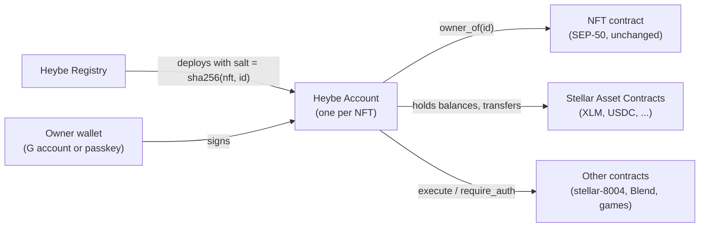
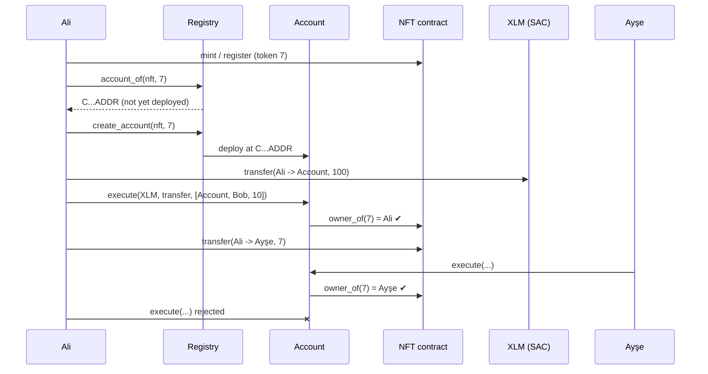

# Architecture

> Draft. Written before implementation; it changes as the contracts land.

## Components



| Component | Role | New code? |
|---|---|---|
| Registry | Computes account addresses and deploys accounts | Yes |
| Account | Holds assets, executes calls, authorizes as the NFT owner | Yes |
| NFT contract | Source of truth for ownership | No |
| Stellar Asset Contracts | Keep the account's XLM / USDC balances | No |

## Address derivation

One account per NFT. The registry builds the salt as:

```
salt = sha256( xdr(nft_contract_address) || be_bytes_u32(token_id) )
```

and deploys with `env.deployer().with_current_contract(salt)`. The resulting contract id depends only on the network, the registry address and the salt. It can be computed:

- on chain with `deployed_address()` (`Registry::account_of`), and
- off chain by hashing the same `ContractIdPreimage` (planned in the TypeScript SDK).

Because the network id is part of the contract id, no separate chain id is needed.

## Ownership resolution

The account stores only `(nft_contract, token_id)`. It never stores an owner. Every `execute` and every `__check_auth` calls `nft_contract.owner_of(token_id)`.

- Transferring the NFT moves control with no Heybe transaction.
- If the NFT contract cannot return an owner (for example, the token was burned), the account cannot authorize anything. See the [threat model](threat-model.md).

## Asset custody

The account is a contract address, so the Stellar Asset Contract keeps its balances in contract data instead of trustlines:

- XLM and issued assets can be sent to the account directly; no trustline is created.
- If an issuer sets `AUTH_REQUIRED`, the issuer must call `set_authorized` for the account before it can receive a balance.
- Other NFTs are held the normal way: the NFT contract records the account as the owner.

## Lifecycle



## Storage and TTL

| Contract | Storage | Contents |
|---|---|---|
| Registry | instance | account wasm hash |
| Registry | persistent | `Created(nft, id)` marker per account |
| Account | instance | `nft`, `token_id`, `state` counter, `locked_until` |

The account extends its instance TTL whenever it is used, and anyone can call `extend_ttl`. Archived entries can be restored, so assets are never lost to archival. Restoring costs a fee.

## Upgradeability

None in the first version. The account code is fixed at deployment. An owner who could swap the code could also swap it right before selling the NFT, which would defeat the sale protections. Upgrade paths will be considered only after a security review.
