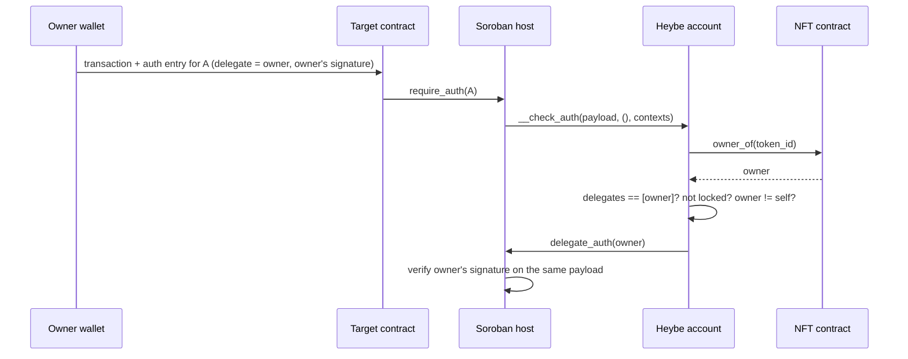

# Auth flows

A Heybe account can act in two ways. Both end with the same rule: only the current owner of the bound NFT can make the account do anything.

## Path A: `execute`

The owner sends a transaction that calls the account:

```
owner signs:  account.execute(target, func, args)
```

1. The account reads `owner = nft.owner_of(token_id)`.
2. It rejects the call if the account is locked or if `owner` is the account itself.
3. It calls `owner.require_auth()`. The owner's signature on the transaction satisfies this, as with any Soroban call.
4. It increments `state` and emits `executed`.
5. It calls `target.func(args)`.

If the target calls `require_auth` on the account (for example `xlm.transfer(from = account, ...)`), Soroban approves it automatically, because the account is the contract that directly invoked the target. No auth entry for the account is needed.

**Example: binding the account as a stellar-8004 agent wallet.**

```
owner signs:
  account.execute(
    identity_registry,
    "set_agent_wallet",
    [caller = owner, agent_id = 7, new_wallet = account]
  )
```

`set_agent_wallet` requires both `caller.require_auth()` and `new_wallet.require_auth()`:

- `caller` is the owner, who signed the transaction.
- `new_wallet` is the account, which is the direct invoker.

Both checks pass. This path works with Freighter and every other wallet today.

## Path B: CAP-71 delegation

Sometimes the account must authorize in a call it did not start. Two examples: a contract further down the call tree asks for the account's auth, or the account is used as a login identity. In those cases Soroban calls the account's `__check_auth`.



The auth entry uses the CAP-71 credential type `SOROBAN_CREDENTIALS_ADDRESS_WITH_DELEGATES`:

```
SorobanAddressCredentialsWithDelegates {
  addressCredentials: { address: <account>, nonce, signatureExpirationLedger, signature: Void },
  delegates: [
    { address: <owner>, signature: <owner's signature>, nestedDelegates: [] }
  ]
}
```

- The account verifies no signature of its own, so its own `signature` is `Void`.
- If the owner is a `G...` account, its delegate signature is a normal ed25519 Stellar signature over the shared payload.
- If the owner is a `C...` smart wallet (for example a passkey wallet), the host runs that wallet's own `__check_auth`. It may carry its own `nestedDelegates`.
- One auth entry covers the whole chain. Before CAP-71, the same delegation needed `require_auth_for_args` inside `__check_auth`, with a separate auth entry and nonce for the owner.

### Simulation

CAP-71 notes that simulation does not enter `__check_auth`, so delegated auth still takes two simulation passes:

1. Simulate to record the account's auth entry.
2. Fill in the owner as a delegate and sign.
3. Simulate again to get final resource numbers.

The demo app and SDK wrap this in one helper.

## Open questions (tested on day 2)

These questions shape the demo and are not yet verified:

1. **Funding before deployment.** Does the Stellar Asset Contract accept a transfer to the account address before `create_account` runs?
   - If not, the demo deploys the account first. Users see no difference.
2. **Delegation in tests.** Does `set_auths` with `AddressWithDelegates` exercise the full Path B in `soroban-sdk` 28 test utilities, including a storage write (the `state` counter) inside `__check_auth`?
3. **Client signing.** Can `@stellar/stellar-sdk` 17.4 build an `AddressWithDelegates` entry that a `G...` key signs and testnet accepts? Can Freighter's `signAuthEntry` produce the delegate signature?
   - If Freighter cannot, the demo uses Path A and Path B is proven by tests and scripts.

Results will be recorded here.
